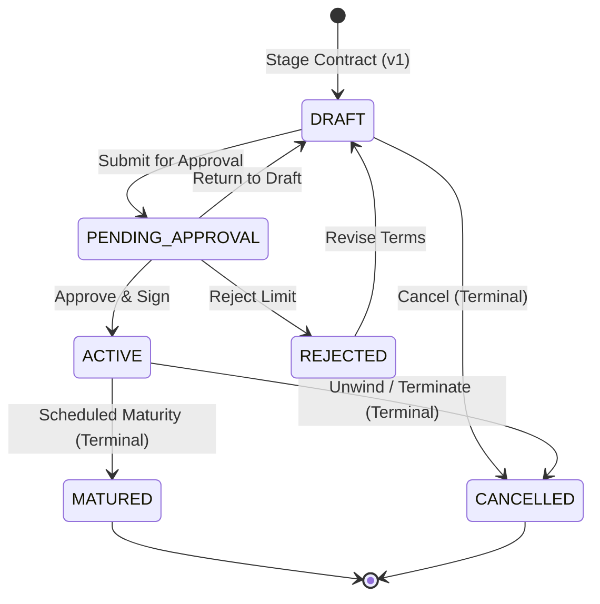

# DerivaQuant — Module 2: Contract Management & Persistent Contract Registry

## 1. Executive Summary

Module 2 delivers the **Contract Management & Persistent Contract Registry** for DerivaQuant. It provides an institutional-grade, database-backed registry for Over-the-Counter (OTC) derivative contracts, replacing previous static mock tables with fully typed, relational persistence, an explicit lifecycle state machine, optimistic concurrency control, immutable audit trails, and versioned snapshot histories.

---

## 2. Supported Instruments & Domain Modeling

Module 2 implements typed, validated domain models for four fundamental OTC derivative asset classes. All monetary notionals and interest rates use decimal-safe representations (avoiding binary float inaccuracies), with explicitly documented conventions.

### 2.1 Interest Rate Swap (IRS)
Bilateral fixed-for-floating interest rate swap:
- **Identifier**: System-generated format `CNT-IRS-{UUID8}`.
- **Counterparty**: Full legal entity name (e.g., `JPMorgan Chase NA`).
- **External Reference**: Optional client booking reference.
- **Notional**: Decimal face amount (`notional > 0`).
- **Currency**: ISO 4217 currency code (e.g., `USD`, `EUR`).
- **Tenor**: `effective_date` and `maturity_date` (`maturity_date > effective_date`).
- **Fixed Leg**: Annualized rate percentage (`fixed_rate`), payer direction (`PAY_FIXED` or `RECEIVE_FIXED`), payment frequency (`SEMI_ANNUAL`, `ANNUAL`, `QUARTERLY`).
- **Floating Leg**: Benchmark index (e.g., `SOFR 3M`, `EURIBOR 6M`), payment frequency.
- **Conventions**: Day-count (`ACT_360`, `ACT_365_FIXED`, `THIRTY_360`), roll adjustment (`MODIFIED_FOLLOWING`), settlement calendar (`US_NY`, `TARGET`).

### 2.2 European Option
Vanilla equity or index option with single terminal exercise:
- **Underlying Asset**: Ticker symbol (e.g., `SPX`, `AAPL`).
- **Option Type**: `CALL` or `PUT`.
- **Exercise Style**: `EUROPEAN` constraint.
- **Strike Price**: Strike price per share/unit (`strike_price > 0`).
- **Trade Premium**: Upfront option premium amount.
- **Notional / Quantity**: Aggregate contract face value.
- **Trade & Expiration Dates**: Validation requires `expiration_date >= trade_date`.
- **Settlement & Direction**: `CASH` or `PHYSICAL`; `BUY` (Long) or `SELL` (Short).

### 2.3 Cross-Currency Swap
Dual-currency interest rate and principal exchange:
- **Currencies**: `pay_currency` and `receive_currency` (strictly validated to ensure they are distinct).
- **Notionals**: `pay_notional` and `receive_notional`.
- **Exchange Terms**: Initial FX exchange rate, principal exchange terms (`INITIAL_AND_FINAL`, `FINAL_ONLY`, `NONE`).
- **Leg Structures**: Rate types (`FIXED` or `FLOATING`) per leg with corresponding fixed coupons or floating reference indices.
- **Tenor & Frequencies**: `effective_date` to `maturity_date`, payment frequencies.

### 2.4 Credit Default Swap (CDS)
Single-name credit default protection:
- **Reference Entity**: Obligor name (e.g., `Ford Motor Credit Co LLC`).
- **Direction**: `BUY_PROTECTION` (Long Credit Risk) or `SELL_PROTECTION` (Short Credit Risk).
- **Face Notional**: Protection amount (`notional > 0`).
- **Spread**: Documented in **Basis Points** (`spread_bps`, where 100 bps = 1.00% annual coupon).
- **ISDA Terms**: Premium frequency (`QUARTERLY`), Restructuring clause (`CR` - Complete Restructuring, `MR` - Modified Restructuring, `MM`, `XR`).

---

## 3. Lifecycle State Machine

Contracts adhere to an explicit finite state machine with strict legal status transitions:



### Transition Rules:
1. **DRAFT**: Terms can be freely modified using `PATCH /contracts/{id}`. Staged contracts can be submitted for approval or cancelled.
2. **PENDING_APPROVAL**: Terms are locked. Can be activated, rejected, or returned to draft for corrections.
3. **ACTIVE**: Live market commitment. Cannot be directly edited. Can be matured upon expiry or cancelled/unwound.
4. **REJECTED**: Rejected by risk; can be returned to DRAFT for amendment.
5. **MATURED** & **CANCELLED**: **Terminal states**. Immutable and irreversible. Any attempted transition returns `HTTP 409 Conflict`.
6. **Optimistic Concurrency**: Every state mutation requires `expected_version`. If another process has incremented the version, an `HTTP 409 Conflict` is returned.

---

## 4. Database Schema & Persistence

The relational data model is managed via **SQLAlchemy 2.x** and **Alembic** migrations:

```
┌────────────────────────────────────────────────────────┐
│                        contracts                       │
├────────────────────────────────────────────────────────┤
│ id (PK)                 BIGINT                         │
│ contract_id (UNIQUE)    VARCHAR(32)                    │
│ external_reference      VARCHAR(100) (INDEX)           │
│ instrument_type         VARCHAR(50) (INDEX)            │
│ counterparty            VARCHAR(150) (INDEX)           │
│ notional                NUMERIC(20, 4)                 │
│ currency                VARCHAR(3)                     │
│ effective_date          DATE (INDEX)                   │
│ maturity_date           DATE (INDEX)                   │
│ status                  VARCHAR(30) (INDEX)            │
│ version                 INTEGER                        │
│ terms                   JSONB / JSON                   │
│ created_at              TIMESTAMP WITH TIME ZONE       │
│ updated_at              TIMESTAMP WITH TIME ZONE       │
└───────────────────────────┬────────────────────────────┘
                            │ 1:N
            ┌───────────────┴───────────────┐
            ▼                               ▼
┌─────────────────────────┐   ┌───────────────────────────┐
│  contract_audit_events  │   │     contract_revisions    │
├─────────────────────────┤   ├───────────────────────────┤
│ id (PK)                 │   │ id (PK)                   │
│ event_id (UNIQUE)       │   │ revision_id               │
│ contract_id (FK)        │   │ contract_id (FK)          │
│ event_type              │   │ version                   │
│ from_status             │   │ status                    │
│ to_status               │   │ snapshot (JSON)           │
│ actor                   │   │ changed_by                │
│ timestamp               │   │ reason                    │
│ diff (JSON)             │   │ created_at                │
│ reason                  │   └───────────────────────────┘
│ version                 │
└─────────────────────────┘
```

### Atomic Commit Guarantees:
Every contract mutation (creation, terms update, or lifecycle transition) executes in a single database transaction that atomically commits:
1. The updated `contracts` record (with `version += 1` and new `updated_at`).
2. An immutable `contract_audit_events` row logging actor, event type, status delta, and JSON diff.
3. A `contract_revisions` row recording a complete historical JSON snapshot of the contract at that version.

---

## 5. REST API Reference (`/api/v1`)

| Method | Endpoint | Description | Status Codes |
|---|---|---|---|
| `GET` | `/api/v1/contracts` | List & filter contracts (search, instrument, status, pagination, sorting) | `200` |
| `POST` | `/api/v1/contracts` | Stage new contract in `DRAFT` state | `201`, `422` |
| `GET` | `/api/v1/contracts/{id}` | Retrieve complete contract details and specific instrument terms | `200`, `404` |
| `PATCH` | `/api/v1/contracts/{id}` | Update terms while in `DRAFT` (requires `expected_version`) | `200`, `404`, `409` |
| `POST` | `/api/v1/contracts/{id}/submit` | Transition `DRAFT` → `PENDING_APPROVAL` | `200`, `409` |
| `POST` | `/api/v1/contracts/{id}/activate` | Transition `PENDING_APPROVAL` → `ACTIVE` | `200`, `409` |
| `POST` | `/api/v1/contracts/{id}/reject` | Transition `PENDING_APPROVAL` → `REJECTED` | `200`, `409` |
| `POST` | `/api/v1/contracts/{id}/return-to-draft`| Transition `PENDING_APPROVAL` or `REJECTED` → `DRAFT` | `200`, `409` |
| `POST` | `/api/v1/contracts/{id}/mature` | Transition `ACTIVE` → `MATURED` (Terminal) | `200`, `409` |
| `POST` | `/api/v1/contracts/{id}/cancel` | Transition `DRAFT` or `ACTIVE` → `CANCELLED` (Terminal) | `200`, `409` |
| `GET` | `/api/v1/contracts/{id}/audit` | Retrieve chronological immutable audit trail | `200`, `404` |
| `GET` | `/api/v1/contracts/{id}/revisions` | Retrieve versioned historical contract snapshots | `200`, `404` |
| `GET` | `/api/v1/contracts/meta/health` | Database connection status and storage engine telemetry | `200` |

---

## 6. How to Run Migrations & Tests

### Running Migrations:
```bash
cd backend
alembic upgrade head
```

### Running Backend Tests:
```bash
pytest backend/tests
```
All 45 unit, lifecycle, repository, and API integration tests pass with 100% green status.

### Running Backend Linter:
```bash
ruff check backend
```

### Running Frontend Tests & Production Build:
```bash
cd frontend
npm test -- --run
npm run lint
npm run build
```

---

## 7. Strict Module Boundaries & Limitations

1. **No Pricing or Black-Scholes Models**: Module 2 explicitly excludes fair-value calculations, Greeks, and yield curve interpolation (deferred to Module 3).
2. **No Real User Auth**: Actor attribution uses operational context fields (`actor: str`); full identity and RBAC are deferred to security integration.
3. **No Automatic Maturation**: Contracts do not self-mature via background tasks without operator intervention or scheduled batch triggers.
